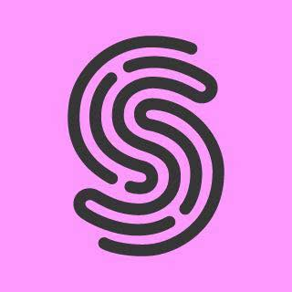




I am an <strong>incoming R&D engineer</strong> in the [Aramis Lab](https://www.aramislab.fr/) at [Inria Paris](https://www.inria.fr/en/inria-paris-centre) and the [Paris Brain Institute](https://parisbraininstitute.org/), affiliated with Sorbonne Université.

I recently graduated from the <strong>Master 2 in [Mathematics, Vision, Learning](https://www.master-mva.com/) (MVA)</strong> at ENS Paris-Saclay, and completed a <strong>6-month research internship</strong> in the same lab on <strong>Sparse Optimal Transport for Large-Scale Datasets</strong>, supervised by [Reuben Dorent](https://reuben.dorent.fr/) (Aramis) and [Tom Vercauteren](https://cai4cai.ml/author/tom-vercauteren/) (King's College London).

Before pivoting to health AI, I earned a <strong>BSc in Economics and Mathematics</strong> from Arizona State University and an <strong>MA in Economics and Social Sciences</strong> from the University of Chicago, followed by pre-doctoral research fellowships at Pompeu Fabra University and the Barcelona School of Economics, and at Sciences Po Paris.

I also took two years away from academia to pursue a personal dream of working as a game designer. [SEED MMO](https://store.steampowered.com/app/2938800/SEED/) is going live this year!

*Keywords of interest: representation learning, cross-modality alignment, optimal transport, foundation models for biology and health, AI for science*
{: .bio-keywords}

